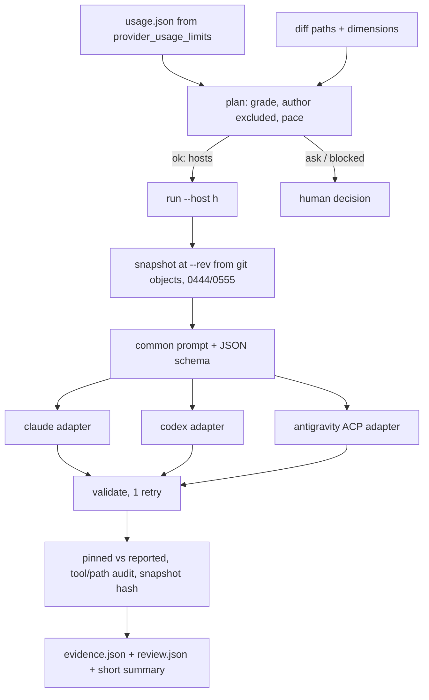

# Change: Host-neutral cross-review runner (`modules/cross-review`)

## Intent

`docs/review-skills/README.md` promised one shared review contract for Claude Code, Codex CLI and
Antigravity (same input, read-only, same output schema, model and effort pinned by policy, failures
reported as `incomplete`) and deferred the contract and adapters to a follow-up (antigravity-host-support
cycle 2 / C6, `filed_followup`). This change implements it as an optional module: one runner, a policy
file, a common output schema, per-host adapters, reviewer selection with pace rules, and evidence files.

Success criteria: host differences live only in adapters; every run is read-only and audited; any
failure or an unconfirmed/mismatched model yields `incomplete` (never a silent switch to another
reviewer); `plan` never picks the author host and asks or blocks instead of guessing.

## Scope

- In scope: `modules/cross-review/` (CLI, policy, lib, adapters, tests), `scripts/test-modules.sh`
  wiring, `docs/review-skills/README.md` (+ template twin), `README.md` and `docs/PROJECT_CONTEXT.md`
  module lists, this record.
- Out of scope: downstream bindings (a project's review skill, quality doc, or slash command calling
  the runner); fetching usage data (the caller saves the T3 MCP `provider_usage_limits` output); a
  `modules/manifest.json` entry (the manifest records downstream-evaluation evidence this module does
  not have yet).

## Current State

Before this change, cross-reviews ran through per-session scripts: an Antigravity ACP runner in view_file
mode proven over cycles r5–r8 of `antigravity-host-support`, and hand-written Codex/Claude invocations.
Its ten ACP rules (isolated `GEMINI_HOME`, `reject_once`, view_file only, `.meta`-matched session cleanup,
...) and the 300 s per-call time-to-first-byte limit of the local proxy were measured there.

## Plan

- [x] Plan
- [x] Implement
- [ ] Review
- [ ] Human QA
- [ ] Merge
- [ ] Post-merge
- [ ] Compound capture

## Tracks

| Track | Status | Changed paths | Verification | Risks |
| --- | --- | --- | --- | --- |
| Modules | Completed | `modules/cross-review/**`, `scripts/test-modules.sh` | `node --test modules/cross-review/test/*.test.mjs`; one real smoke per host | Medium — host CLIs change flags between releases; adapters were verified against Claude Code 2.1.332, codex-cli 0.167.0, agy_acp_server 1.4.5 |
| Docs | Completed | `docs/review-skills/README.md`, `templates/docs/review-skills/README.md`, `README.md`, `docs/PROJECT_CONTEXT.md`, this file | `scripts/check-harness-sync.sh --forgekit`, `scripts/test-check-harness-sync.sh` | Low |
| Server / Deploy / Frontend / App | Skipped | N/A | N/A | Harness repo only |

## Architecture and Flow

## Implementation Notes

- Zero dependencies, plain `.mjs` (Node 20+). Node type stripping was not used so CI's stock Node works
  without flags; the CI job's Bun install is untouched.
- Policy (`review-policy.json`) is the only place for model ids: Claude `claude-opus-5-5` (the current
  Opus id; `claude --help` accepts full names and the live `init` event reported it), Codex
  `gpt-6.1-sol`, Antigravity `gemini-4-neon`, all at `review_effort: high`. It also holds id prefixes,
  grade dimensions and path globs, pace thresholds (marked provisional), per-host usage windows,
  expected cost (Antigravity 0.01 of the weekly window per full review, measured r5/r6), timeouts and
  the Antigravity runtime paths.
- Usage windows are listed per host because the Antigravity payload also carries `shared_3p_*` windows
  (Claude/GPT via Antigravity) that are `notStarted` and do not meter the Gemini reviewer; counting them
  would make Antigravity permanently `ask`.
- Default dimensions are `correctness, tests, contract_docs`. `security` is not a default because rule
  "security dimension ⇒ high grade" would make every run high grade; callers add it when the change
  needs a security review (see Follow-ups).
- Codex runs in plain mode, not `--json`: only the plain stderr header reports the resolved model,
  effort, sandbox and approval policy, so the adapter asserts `sandbox: read-only`, `approval: never` and
  the effort there, and audits `exec` blocks from the same transcript.
- Claude uses `--output-format stream-json --verbose` for the audit (`init` lists tools, MCP servers and
  permission mode) and `--json-schema` for structured output. A small internal model may appear in
  `modelUsage`; that is a warning, but the pinned model must be present.
- Antigravity is a port of the proven view_file runner with the same rules; dimension groups come from
  the policy (`groups`), restricted to the run's dimensions.
- `run` refuses an `--out` that is inside the repository and not git-ignored.
- Dispositions use the requested vocabulary `fixed|followup|accepted|blocked`; the README maps them to
  the change-record vocabulary.

### Guarantees per host (flag level)

| Guarantee | Claude | Codex | Antigravity |
| --- | --- | --- | --- |
| Read-only tools | `--tools Read,Grep,Glob`, `--allowedTools` same, `--permission-mode dontAsk`, `--permission-prompts none`, `--restricted` | `-s read-only`, `-c approval_policy="never"` | `enabledTools:["view_file"]`, fs/terminal false, `reject_once` |
| Read confinement | `--restricted` (host-enforced; an outside read was denied in the flag probe) + audit | audit only (gap) | audit |
| Network | no web/shell tools, `CLAUDE_CODE_DISABLE_NONESSENTIAL_TRAFFIC=1` | sandbox, `-c web_search="disabled"` | web tools not enabled |
| MCP | `--strict-mcp-config --mcp-config '{"mcpServers":{}}'`, `--safe-mode` | `--ignore-user-config`, `--disable plugins`/`apps` | `mcpServers: []`, isolated home without `config/` |
| Delegation | no Agent tool | `--disable multi_agent`, `multi_agent_v2` | `invoke_subagent` not enabled |
| User settings | `--setting-sources ""`, `--restricted`, `--safe-mode`, `--disable-slash-commands` | `--ignore-user-config`, `--ignore-rules` | isolated `GEMINI_HOME` |
| Session persistence | `--no-session-persistence` | `--ephemeral` | not available; files deleted when `.meta` cwd matches |
| Bypass flags | none; argv checked against the bypass list | none; argv checked | `allow_*`/`reject_always` never chosen |

## Documentation Updates

- Updated docs: `modules/cross-review/README.md` (new), `docs/review-skills/README.md` and its
  template twin (runner usage replaces "contract and adapters are added in a follow-up"), `README.md`
  and `docs/PROJECT_CONTEXT.md` module lists, this record.

## Verification

- `node --test modules/cross-review/test/*.test.mjs`: 48 tests pass (plan/grade/pace/selection, schema
  and dispositions, pinned-vs-reported, adapter argv and session parameters, transcript/stream audits,
  process helper, fake-host end-to-end runs including retry, re-review, outside reads, snapshot writes,
  model mismatch, missing binary). No test calls a model.
- `bash scripts/check-harness-sync.sh --forgekit`: in sync. `bash scripts/test-check-harness-sync.sh`:
  70 cases pass. `scripts/test-modules.sh` as a whole was not run locally because `bun` is not
  installed (CI runs it).
- Flag probes before implementation (2026-11-26, tiny prompts in a scratch dir): Codex read-only run
  (write refused, `../outside.txt` attempt visible in the transcript, header shows model/sandbox/
  approval/effort; `--json` omits them); Claude run with the final flag set (tools
  `Glob,Grep,Read,StructuredOutput`, `mcp_servers: []`, outside read denied by `--restricted`, no
  file created).
- Real smoke per host (scope: `modules/cross-review/lib/proc.mjs`, dimension `correctness`):
  see "Real smoke runs" below.

### Real smoke runs

| Host | Rev | Status | Model reported | Time | Cost | Findings |
| --- | --- | --- | --- | --- | --- | --- |
| Codex | 484d0da | complete | gpt-6.1-sol / high (header) | 43 s | 16,149 tokens | 3 med (X1–X3) |
| Claude | 484d0da | complete | claude-opus-5-5 (init + modelUsage) | 37 s | $0.15 list price, 3,588 output tokens | 3 med, 2 low (C1–C5) |
| Antigravity | 6ba9ad6 | complete | gemini-4-neon / high (config + proxy `gemini-4-neon-high` on both calls) | 235 s (one turn, 229 s) | 37,728 tokens (23,498 thought); quota delta not measurable, see note | 1 high, 2 med, 1 low (A1–A4) |

Antigravity audit: 1 `view_file` call, 0 paths outside the snapshot, 0 permission requests, 0 client
requests, isolated home had no `config/`, session files (`.db`, `.meta`, `brain/`) removed after the
`.meta` cwd matched, no leftover `agy` processes from the run. Quota: `provider_usage_limits` before
the run showed Gemini 5h 0.9368 / weekly 0.8221 (observed 03:53Z); the tool only serves cached data
and had not refreshed by the end of the session (`stale`), and three other T3-owned `agy_acp_server`
processes were running at the same time, so the delta of this one run cannot be isolated. By tokens
it is well under the r5/r6 full reviews that measured ~0.01 weekly.

## Review Cycles

| Cycle | Type | Findings | Resolution |
| --- | --- | --- | --- |
| 1 | Self-review + fake-host tests | `else` bound to the inner `if` in the Claude stream parser (result event ignored); outside-path check broke on macOS `/tmp` → `/private/tmp`. | Fixed before the first commit. |
| 2 | Real smoke cross-review of `lib/proc.mjs` at 484d0da (Codex X1–X3, Claude C1–C5) | X2/C1 resolved on `exit`, output could be truncated; X1/C2 delayed SIGKILL could hit a reaped group; X3/C4 bypass guard missed `--add-dir=`, `--yolo=`, `-y`, `--approval-mode`; C3 missing timeout killed at once; C5 duration included cleanup sleep. | Fixed in 6ba9ad6 with tests (`test/proc.test.mjs`, bypass guard test). |
| 3 | Real smoke cross-review of `lib/proc.mjs` at 6ba9ad6 (Antigravity A1–A4) | A1 (high) a descendant that left the group (setsid) but kept stdout/stderr open blocked `close` forever; A2 the post-close leftover kill has a ps→kill window; A3 unanchored substring patterns scanned every argv token (a temp dir named like `…YoLo…` would be a false positive); A4 sync spawn failure result lacked `leftoversKilled`. | A1, A3, A4 fixed in the cycle-3 commit with tests (setsid descendant, value-position and path/JSON cases). A2 accepted (see Residuals). |

## Branch & Merge Evidence

- Working branch: `agent/cross-review-runner` (based on `agent/antigravity-support` @ f9aa6ff, not yet merged)
- Target branch: `main` (after `agent/antigravity-support`)
- PR URL: TBD (no PR in this step)

## Residuals

| Source | Finding | Disposition | Link/reason |
| --- | --- | --- | --- |
| Cycle 3 / A2 | Leftover-group SIGKILL after `close` has a window between the `ps` check and `kill` | `accepted_with_reason` | The kill is sent only when `ps` shows live members of the group, and a pgid is not reused while it has members; the remaining window needs the last member to exit and its id to be reused as a new group leader within microseconds |
| Design | Codex read-only sandbox does not confine reads to the snapshot | `accepted_with_reason` | No codex-cli 0.167.0 flag restricts read roots; detected from the transcript and the run is marked incomplete |
| Design | Claude effort level is not reported by the host | `accepted_with_reason` | Recorded as pinned only; listed in `hostLimits` |
| Design | Antigravity session persistence cannot be disabled | `accepted_with_reason` | Files deleted after the run when `.meta` cwd matches (same as T3) |
| antigravity-host-support C6 | Shared review contract and per-host adapters | `fixed` | This change |

## Compound Capture

- Reusable learning captured: pending — candidate for `docs/HARNESS_NOTES.md`: Codex plain mode is the
  only place the resolved model/sandbox are visible; usage windows must be filtered per reviewer model.

## Follow-ups

- Downstream binding (project review skill / quality doc calling `plan` then `run`).
- Decide whether `security` should be a default dimension given that it forces high grade.
- Calibrate pace thresholds (provisional) and expected cost per host from recorded runs.
- Promote via `modules/manifest.json` after a downstream evaluation.
