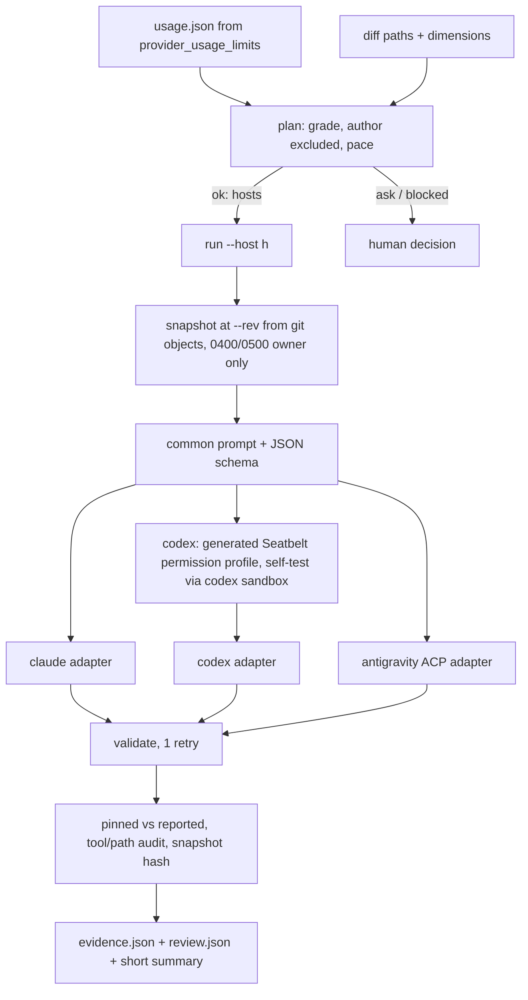

# Change: Host-neutral cross-review runner (`modules/cross-review`)

## Intent

`docs/review-skills/README.md` promised one shared review contract for Claude Code, Codex CLI and
Antigravity (same input, read-only, same output schema, model and effort pinned by policy, failures
reported as `incomplete`) and deferred the contract and adapters to a follow-up (antigravity-host-support
cycle 2 / C6, `filed_followup`). This change implements it as an optional module: one runner, a policy
file, a common output schema, per-host adapters, reviewer selection with pace rules, and evidence files.

Success criteria: host differences live only in adapters; every run is read-only and audited; any
failure or an unconfirmed/mismatched model yields `incomplete` (never a silent switch to another
reviewer); `plan` never picks the author host and asks or blocks instead of guessing.

## Scope

- In scope: `modules/cross-review/` (CLI, policy, lib, adapters, tests), `scripts/test-modules.sh`
  wiring, `docs/review-skills/README.md` (+ template twin), `README.md` and `docs/PROJECT_CONTEXT.md`
  module lists, this record.
- Out of scope: downstream bindings (a project's review skill, quality doc, or slash command calling
  the runner); fetching usage data (the caller saves the T3 MCP `provider_usage_limits` output); a
  `modules/manifest.json` entry (the manifest records downstream-evaluation evidence this module does
  not have yet).

## Current State

Before this change, cross-reviews ran through per-session scripts: an Antigravity ACP runner in view_file
mode proven over cycles r5–r8 of `antigravity-host-support`, and hand-written Codex/Claude invocations.
Its ten ACP rules (isolated `GEMINI_HOME`, `reject_once`, view_file only, `.meta`-matched session cleanup,
...) and the 300 s per-call time-to-first-byte limit of the local proxy were measured there.

## Plan

- [x] Plan
- [x] Implement
- [x] Review (r1–r5 cross-review cycles; r4 and r5 had no high/critical; r5 test/doc fixes below; ready for PR)
- [ ] Human QA
- [ ] Merge
- [ ] Post-merge
- [ ] Compound capture

## Tracks

| Track | Status | Changed paths | Verification | Risks |
| --- | --- | --- | --- | --- |
| Modules | Completed | `modules/cross-review/**`, `scripts/test-modules.sh` | `node --test modules/cross-review/test/*.test.mjs`; one real smoke per host | Medium — host CLIs change flags between releases; adapters were verified against Claude Code 2.1.332, codex-cli 0.167.0 (OS sandbox re-verified on 0.172.0), agy_acp_server 1.4.5 and the Antigravity 1.5.18 CLI runtime |
| Docs | Completed | `docs/review-skills/README.md`, `templates/docs/review-skills/README.md`, `README.md`, `docs/PROJECT_CONTEXT.md`, this file | `scripts/check-harness-sync.sh --forgekit`, `scripts/test-check-harness-sync.sh` | Low |
| Server / Deploy / Frontend / App | Skipped | N/A | N/A | Harness repo only |

## Architecture and Flow

## Implementation Notes

- Zero dependencies, plain `.mjs` (Node 20+; the Antigravity 1.5 runtime path needs Node 22.13+ for
  `node:sqlite`, and without it fails closed as `model_unconfirmed`; its tests are skipped there). Node
  type stripping was not used so CI's stock Node works without flags; the CI job's Bun install is untouched.
- Policy (`review-policy.json`) is the only place for model ids: Claude `claude-opus-5-5` (the current
  Opus id; `claude --help` accepts full names and the live `init` event reported it), Codex
  `gpt-6.1-sol`, Antigravity `gemini-4-neon`, all at `review_effort: high`. It also holds id prefixes,
  grade dimensions and path globs, pace thresholds (marked provisional) and `reset_soon_minutes`,
  per-host usage windows, expected cost per window kind (Antigravity weekly 0.01 measured r5/r6,
  session/5 h 0.04 and Codex weekly 0.01 measured on the r1 runner review), timeouts, the Codex
  code-execution flag, per-host `env_passthrough`, Antigravity turn-split limits and runtime paths.
- Usage windows are listed per host because the Antigravity payload also carries `shared_3p_*` windows
  (Claude/GPT via Antigravity) that are `notStarted` and do not meter the Gemini reviewer; counting them
  would make Antigravity permanently `ask`.
- Default dimensions are `correctness, tests, contract_docs`. `security` is not a default because rule
  "security dimension ⇒ high grade" would make every run high grade; callers add it when the change
  needs a security review (see Follow-ups).
- Codex runs in plain mode, not `--json`: only the plain stderr header reports the resolved model,
  effort, sandbox and approval policy, so the adapter asserts `sandbox: read-only`, `approval: never` and
  the effort there, and audits `exec` blocks from the same transcript.
- Claude uses `--output-format stream-json --verbose` for the audit (`init` lists tools, MCP servers and
  permission mode) and `--json-schema` for structured output. A small internal model may appear in
  `modelUsage`; that is a warning, but the pinned model must be present.
- Antigravity is a port of the proven view_file runner with the same rules; dimension groups come from
  the policy (`groups`), restricted to the run's dimensions.
- `run`, `plan --out` and `merge --out` refuse an output inside the repository unless it is git-ignored
  (checked against the index, so tracked files never pass) and never under `.git/`.
- `--checklist` is repeatable (one path each) and read from the git object at `--rev`, or from an
  explicit file outside the repository; source and sha256 are recorded.
- `run` writes `summary.txt` next to the evidence; `merge` combines several hosts' `review.json` into
  one deduplicated summary (same file within a few lines + similar claim/evidence → one group, every
  host's id kept).
- Codex `allow_code_execution` (policy, default `true`): model-run commands may run interpreters
  under the OS sandbox. Since r3 it only decides whether node's package dir is granted; code execution
  seen in the transcript is an evidence warning. Other hosts cannot enable it.
- Codex OS sandbox (r2, user decision "OS-enforced confinement instead of shell parsing"): the runner
  generates a Codex permission profile (`default_permissions` + `permissions.<name>.filesystem`, a
  random name per run) that Codex compiles into the Seatbelt profile of every model-run command:
  read `:minimal` + snapshot + codex/node install roots, `/private/tmp` and `/private/var/tmp`
  denied, no writes, no network. `codex exec` gets no `-s` (it would override the profile with
  full-disk read; verified). A self-test through `codex sandbox` (no model call) must show an outside
  probe read, a Codex-home listing and a snapshot write denied and a snapshot read allowed, else the
  run is `incomplete` before codex exec starts. No Seatbelt → always `no_os_sandbox` (r3 removed the
  `audit_only` mode). The requested design (an outer `sandbox-exec` around
  `codex exec` with a runner-written SBPL) was tried first and is impossible: macOS rejects a nested
  `sandbox_apply` inside any restrictive profile (even `(deny file-write*) (allow file-write*
  (subpath "/"))`), and Codex starts every command through `sandbox-exec`, so every command failed
  with exit 71. The generated profile, its hash and the self-test are in the evidence.
- Shell audit (r2): a secondary signal. Only clear violations the sandbox would have caught anyway
  (literal outside path to a file-reading command or redirection, `cd` out, cwd outside, disallowed
  code execution, tool-like lines, unreadable header) are `incomplete`; the rest are warnings. The r1
  R2 rule (literal paths inside interpreter programs → incomplete) is removed.
- r3 simplification (orchestrator decision: "the OS sandbox is the primary control"): once the
  self-test has passed, the Codex shell-command audit is **evidence only** and never makes a run
  incomplete (every command finding is a `shell audit (evidence only)` warning). Incomplete reasons
  stay only for what the sandbox does not govern: the header (model, effort, `sandbox`, `approval`,
  workdir), an unreadable transcript, and non-shell tool sections (MCP, web search, `apply_patch`).
  `os_sandbox: "audit_only"` is removed: without an OS sandbox the run is always `no_os_sandbox`. The
  sandbox denial counter (`deniedOps`) is dropped: plain-mode output has no marker that separates a
  real denial from printed text ("not counted" is recorded in the evidence). Why: r1–r3 each found new
  audit bypasses and false positives (A35–A38, A36/X10, A49, A51, X21; r3's only incomplete reason was
  `ls -l` of the allowed node binary), while the self-tested profile already decides what any command
  can read.
- r3 sandbox profile: runtime grants are the exact versioned package dir (basename starts with a
  version, ≤ 3 levels above the binary) or npm package dir, otherwise the binary file itself — never a
  shared prefix; grants that are or contain `/`, `$HOME`, `CODEX_HOME` or a denied path, and runtime
  grants inside a denied path, are refused (`os_sandbox_profile_refused`); denials are written after
  the grants. The self-test runs `codex sandbox` with the exact exec config flags
  (`configArgs`: profile, approval, web_search, every `--disable`) and `CODEX_HOME` = an empty private
  dir (`codex sandbox` has no `--ignore-user-config`), and also probes harmless files in
  `/private/tmp` and `$HOME`. The bypass guard accepts a sensitive `-c` only when it is byte-for-byte a
  value the runner generated (`allowedConfig`).
- r4: the Codex argv guard is an allowlist of the exact shape the runner builds (no `-s`, no profile,
  every `-c` one of the generated values and all of them present); `-c` keys are TOML-decoded for the
  generic guard. The self-test needs every probe file (os.tmpdir, `/private/tmp`, `/private/var/tmp`,
  `$HOME`): a probe that cannot be created is `os_sandbox_selftest_unavailable`, never a pass. Grants
  are compared and recorded canonicalized (symlinks, case on macOS). Claude brace globs over 64
  alternatives are decided by an automaton (relative-only pass; escaping → `tool_glob_unauditable`).
  Antigravity turns and budget come from one helper (`lib/turns.mjs`) for plan and run, with a floor
  (`min_total_sec`) and the `rereview_single_group` speed knob.
- Dispositions use the requested vocabulary `fixed|followup|accepted|blocked`; the README maps them to
  the change-record vocabulary.

### Guarantees per host (flag level)

| Guarantee | Claude | Codex | Antigravity |
| --- | --- | --- | --- |
| Read-only tools | `--tools Read,Grep,Glob`, `--allowedTools` same, `--permission-mode dontAsk`, `--permission-prompts none`, `--restricted` | generated permission profile without write entries (header `sandbox: read-only`), `-c approval_policy="never"` | ≤1.4: `enabledTools:["view_file"]`; 1.5: ignored, so only the audit (non-read tool → incomplete); both: fs/terminal false, `reject_once`, 1.5 session mode `default` |
| Read confinement | `--restricted` (host-enforced; an outside read was denied in the flag probe) + audit | OS-enforced Seatbelt profile (self-tested per run); shell audit is evidence only | audit |
| Network | no web/shell tools, `CLAUDE_CODE_DISABLE_NONESSENTIAL_TRAFFIC=1` | profile has no network entry, `-c web_search="disabled"` | ≤1.4: web tools not enabled; 1.5: `search_web` is available and can run before the audit makes the run incomplete |
| MCP | `--strict-mcp-config --mcp-config '{"mcpServers":{}}'`, `--safe-mode` | `--ignore-user-config`, `--disable plugins`/`apps` | `mcpServers: []`, isolated home without `config/` |
| Delegation | no Agent tool | `--disable multi_agent`, `multi_agent_v2` | ≤1.4: `invoke_subagent` not enabled; 1.5: available, caught after the fact by the audit |
| User settings | `--setting-sources ""`, `--restricted`, `--safe-mode`, `--disable-slash-commands` | `--ignore-user-config`, `--ignore-rules` | isolated `GEMINI_HOME` |
| Session persistence | `--no-session-persistence` | `--ephemeral` | not available; files deleted when `.meta` cwd (≤1.4) or the session database's session id + workspace (1.5) match |
| Bypass flags | none; argv checked against the bypass list | none; argv checked | `allow_*`/`reject_always` never chosen; the 1.5 argv is checked against the bypass list before spawn |

## Documentation Updates

- Updated docs: `modules/cross-review/README.md` (new), `docs/review-skills/README.md` and its
  template twin (runner usage replaces "contract and adapters are added in a follow-up"), `README.md`
  and `docs/PROJECT_CONTEXT.md` module lists, this record.

## Verification

- After the rebase onto main 9fecd93 (2026-11-27): `node --test modules/cross-review/test/*.test.mjs`:
  166 tests, 165 pass, 1 skipped (Linux-only boot-time case), 0 fail. Real Antigravity smoke `run`
  (1 file, `lib/merge.mjs`, correctness): complete, `gemini-4-neon`/high reported, both
  `gen_metadata` rows `gemini-4-neon-high`, `matchesPinned: true`, `pipesClosed: true`, one owned
  session cleaned. Its one finding (`prior_verification` entries not shape-checked in merge; a
  `verified: "false"` entry read as verified) was fixed with a test (fails without the fix).
  Evidence: `stem-d/reviews/r9/smoke/out/`.
- After the r8 delta follow-up (2026-11-27): 161 tests pass; the 3 new/extended tests (X35/A87, A84,
  A86) fail on the c764be6 sources. Every incoming message in all saved real Antigravity runs (r2–r8,
  smoke) is a JSON-RPC 2.0 object, so the stricter stdout check has no known false positive.
- After the r8 full-PR fixes (2026-11-27): `node --test modules/cross-review/test/*.test.mjs`: 159
  tests pass (12 new). Run against the 4ac78e9 sources (new tests and fixtures, old code), all 12 new
  tests fail there (X31–X38, A82, A84–A86). A82 also reproduced by hand on APFS before the fix (all four
  case variants accepted) and refused after it.
- After the r7 single-turn change (2026-11-27, now rebased onto forgekit PR #26 head 2a81372):
  `node --test modules/cross-review/test/*.test.mjs`: 147 tests pass. Mutation checks on scratch
  copies, each failing at least one test: `layoutConfig` ignoring the layout (13 fail), the adapter
  using the raw policy instead of `layoutConfig` (9), `TURN_DEFAULTS.max_files_per_turn` dropped (1),
  `plan` ignoring the layout (2), `par_layout` applied under `PAR_LAYOUT_DEFAULTS` instead of over it
  (3), the per-turn timeout read from the top level instead of the layout config (1).
- After the r4 fixes (2026-11-26): `node --test modules/cross-review/test/*.test.mjs`: 132 tests pass
  (8 files; the real-codex `codex sandbox` self-test ran, not skipped). Run against the 481a88c
  sources (new tests, old code), 10 tests fail there (adapters.test.mjs fails at load: `tomlKey` does
  not exist; A63/A65/A66/rereview, A64, both codex sandbox run tests, A53/A61, A60, A62).
  `scripts/check-harness-sync.sh --forgekit` in sync; `scripts/test-check-harness-sync.sh` 70 cases pass.
- After the r3 fixes (2026-11-26): `node --test modules/cross-review/test/*.test.mjs`: 126 tests pass
  (8 files; the real-codex `codex sandbox` self-test with the exact exec flags ran, not skipped). Run
  against the e64a80c sources (new tests, old code; Antigravity/plan helpers shimmed so the file
  loads), 29 of the new/changed tests fail there. `scripts/check-harness-sync.sh --forgekit` in sync;
  `scripts/test-check-harness-sync.sh` passes (see the r3 cycle row).
- After the r2 fixes (2026-11-26): `node --test modules/cross-review/test/*.test.mjs`: 115 tests pass
  (8 files, new `sandbox.test.mjs`); run against the c8a846c sources, 23 of the new/changed tests fail
  there (the A43/A24/A46 test-only additions pass on both). `scripts/check-harness-sync.sh --forgekit`
  in sync; `scripts/test-check-harness-sync.sh` 70 cases pass.
- OS sandbox proofs (macOS 27.2, no model call): `sandbox-exec -p <deny-read profile> /bin/cat
  <outside probe>` → EPERM, snapshot file readable (`test/sandbox.test.mjs`); real
  `codex sandbox` with the generated profile: outside probe read, `~/.codex` listing, `~/.zshrc` read
  and snapshot write → `Operation not permitted`, snapshot read OK, `nc -z 1.1.1.1 443` refused (it
  succeeds outside the sandbox); with `-s read-only` added, `~/.zshrc` became readable (why `-s` is
  never passed). Nested-sandbox probe: any restrictive outer profile → inner `sandbox_apply: Operation
  not permitted` (exit 71).
- After the r1 fixes: `node --test modules/cross-review/test/*.test.mjs`: 91 tests pass (7 files, incl.
  new `antigravity.test.mjs` with an ACP stub and `cli.test.mjs`); every new regression test was run
  against the f1780ef sources and fails there. `scripts/test-modules.sh` now globs the test files.
  The new Codex auditor replayed on the real r1 Codex transcript: 21 commands parsed (multi-line
  included), prompt echo matched, 0 unauditable; 4 model-written `node -e` programs that contain
  literal outside paths (`/etc/passwd`, `/tmp/snap-x`, `/snapshot` in its own repro strings) are now
  flagged, so that run would be `incomplete` under the new rules (intended conservative outcome).
- Before the r1 fixes: `node --test modules/cross-review/test/*.test.mjs`: 48 tests pass (plan/grade/pace/selection, schema
  and dispositions, pinned-vs-reported, adapter argv and session parameters, transcript/stream audits,
  process helper, fake-host end-to-end runs including retry, re-review, outside reads, snapshot writes,
  model mismatch, missing binary). No test calls a model.
- `bash scripts/check-harness-sync.sh --forgekit`: in sync. `bash scripts/test-check-harness-sync.sh`:
  70 cases pass. `scripts/test-modules.sh` as a whole was not run locally because `bun` is not
  installed (CI runs it).
- Flag probes before implementation (2026-11-26, tiny prompts in a scratch dir): Codex read-only run
  (write refused, `../outside.txt` attempt visible in the transcript, header shows model/sandbox/
  approval/effort; `--json` omits them); Claude run with the final flag set (tools
  `Glob,Grep,Read,StructuredOutput`, `mcp_servers: []`, outside read denied by `--restricted`, no
  file created).
- Real smoke per host (scope: `modules/cross-review/lib/proc.mjs`, dimension `correctness`):
  see "Real smoke runs" below.

### Real smoke runs

| Host | Rev | Status | Model reported | Time | Cost | Findings |
| --- | --- | --- | --- | --- | --- | --- |
| Codex | 484d0da | complete | gpt-6.1-sol / high (header) | 43 s | 16,149 tokens | 3 med (X1–X3) |
| Claude | 484d0da | complete | claude-opus-5-5 (init + modelUsage) | 37 s | $0.15 list price, 3,588 output tokens | 3 med, 2 low (C1–C5) |
| Antigravity | 6ba9ad6 | complete | gemini-4-neon / high (config + proxy `gemini-4-neon-high` on both calls) | 235 s (one turn, 229 s) | 37,728 tokens (23,498 thought); quota delta not measurable, see note | 1 high, 2 med, 1 low (A1–A4) |
| Codex under the OS sandbox (r2) | scratch repo, 1 file | incomplete by design | gpt-6.1-sol / high (header; codex-cli 0.172.0) | ~1 min | 24,481 tokens | draft: 1 med (X1, the planted `a - b` bug) kept as `reviewIfIncomplete` |
| Codex, narrowed r3 profile | scratch repo, 1 file | complete | gpt-6.1-sol / high (header; codex-cli 0.172.0) | 11 s | 12,296 tokens | 1 med (X1, the planted `a + b` in `sub`) |
| Codex, r4 fixes (exact argv shape, 4-probe self-test) | bf09019, `lib/turns.mjs`, correctness | complete | gpt-6.1-sol / high (header) | 42 s | 6,916 tokens | none (pass) |

r4 smoke: the exact-shape guard accepted the real argv (`exec -m -c×5 --disable×11 --ephemeral
--ignore-user-config --ignore-rules --skip-git-repo-check -C --color --output-schema -o -`, no `-s`);
self-test ok with all four probe files created (os.tmpdir, `/private/tmp`, `/private/var/tmp`, `$HOME`)
and denied, Codex-home listing and snapshot write denied, snapshot read ok, `unavailable: []`, no probe
errors; read roots `:minimal`, the snapshot, the codex release dir, the node version dir (canonical
paths); no warnings.

r3 smoke: read roots `:minimal`, the snapshot, `~/.codex/packages/standalone/releases/0.172.0-aarch64-apple-darwin`,
`~/.local/share/node/v22.23.5`; denied `/private/tmp`, `/private/var/tmp`. Self-test: outside,
`/private/tmp` and `$HOME` probe reads, Codex-home listing and snapshot write denied, snapshot read
ok, user config not loaded. One command (`cat sub.mjs`), no warnings, argv without `-s`; the probe
directories were removed.

r2 smoke: the brief asked the model to try `cat /etc/hosts | head -1` and `ls ~` once. Self-test ok;
`ls ~` was refused by the sandbox (the model reported `Operation not permitted`; Codex did not list
that command in the transcript); `/etc/hosts` is in Codex's `:minimal` platform set and was read, and
the secondary audit made the run `incomplete` (`tool_read_outside_snapshot:/bin/zsh -lc 'cat
/etc/hosts | head -1' -> /etc/hosts`) while keeping the correct draft. argv had no `-s`.

Antigravity audit: 1 `view_file` call, 0 paths outside the snapshot, 0 permission requests, 0 client
requests, isolated home had no `config/`, session files (`.db`, `.meta`, `brain/`) removed after the
`.meta` cwd matched, no leftover `agy` processes from the run. Quota: `provider_usage_limits` before
the run showed Gemini 5h 0.9368 / weekly 0.8221 (observed 03:53Z); the tool only serves cached data
and had not refreshed by the end of the session (`stale`), and three other T3-owned `agy_acp_server`
processes were running at the same time, so the delta of this one run cannot be isolated. By tokens
it is well under the r5/r6 full reviews that measured ~0.01 weekly.

### Antigravity runtime 1.5 (2026-11-26)

T3 replaced the Antigravity runtime with 1.5.18 (`versions/<releaseId>/` holding one `antigravity`
executable and `.install-complete.json`; the `agy_acp_server.par` directories are gone), so r10 failed
with `runtime_not_found`. Launch facts were taken read-only from T3 (`origin/custom/local`:
`antigravityAuthSupport.ts` `buildAntigravityAcpSpawnInput`, `AntigravitySessionFiles.ts`,
`Drivers/antigravityUsageReader.ts`), `antigravity --help` / `antigravity acp --help`, the profile's
`log/acp-server-*.log`, and two isolated probe sessions (their session files were removed after their
database workspace matched the probe cwd).

| Aspect | ≤1.4 (`par`) | 1.5 (`cli`) | Adapter change |
| --- | --- | --- | --- |
| Discovery | dir name = version, `agy_acp_server.par` | `.install-complete.json` `version` + `executable.name` | `runtimeEntry`: plain file name, regular non-symlink executable of the recorded size; highest version of either layout |
| argv | `agy_acp_server.par` | `antigravity acp --gemini-dir <home> --app-data-dir antigravity-acp` (T3's argv) | + `--log-file <tmp>/agy-server.log --disable-telemetry` |
| Env | harness path, BROWSER helper | `AGY_CLI_DISABLE_AUTO_UPDATE=1`; ignores BROWSER | no harness var; `open`/`xdg-open` shims on PATH → `auth_required` marker |
| Sign-in | files in `antigravity-acp/` | OS keyring entry (`ChainedAuth: authenticated via keyring`), same as the running T3 | none needed; the symlink is unchanged and no credential file is read |
| Model per turn | stderr `Proxy extracted model from path: gemini-4-neon-high` | no proxy, nothing on stderr; `conversations/<id>.db` `gen_metadata` rows: field 19 `gemini-4-neon`, field 21 `Gemini 4 Neon (High)` | every turn must add ≥ 1 row and every row must equal the pin (`model_unconfirmed:*`, `generation_model_mismatch:*`); unreadable DB → incomplete |
| Errors | stderr | `--log-file` (glog lines) | the log is polled with the same fatal/upstream checks; saved as `raw/antigravity-server.log` with e-mail addresses removed |
| Tool allowlist | `enabledTools:["view_file"]` honoured | ignored (probe: `run_command`, `update_steps` offered with `enabledTools:["read_file"]`); read tool is `read_file` with ACP `name`/`args` | audit by `name`: `read_file`/`view_file` (paths audited), `update_steps` (no path); anything else → `non_view_file_tool_calls`. Commands still need a permission (probe: `run_command` asked, `reject_once`, failed). Session must start in mode `default` |
| Session cleanup | `.meta` cwd | no `.meta`; `trajectory_metadata_blob` session id + workspace URIs | delete `.db*`, `brain/<id>`, `annotations/<id>.pbtxt` only when the DB's session id matches and every workspace URI realpath equals the snapshot |
| Process match | `agy_acp_server`/`localharness_external` | `…/antigravity acp …` | `isAgy` also matches `antigravity acp` and this run's executable (ps args kept to 1000 chars) |
| 300 s TTFB wall | local proxy | no proxy (none observed) | r7: one turn for every dimension on 1.5 (split only above 32 files / 400 KB); ≤1.4 keeps the group/chunk split (`par_layout`) |

Safety properties kept: isolated GEMINI_HOME with only `antigravity-acp/` linked, runner as ACP
client with fs/terminal off and `reject_once` for every permission, process-group cleanup, pinned vs
reported model with `incomplete` on mismatch or when the model cannot be read, turn and chunk
budgeting, session cleanup only on proven ownership. Weakened: the runtime-level `enabledTools`
allowlist (1.5 ignores it); the restriction is now the after-the-fact audit plus the permission gate
(see Residuals).

Smoke (1.5.18, 7613dcc, `lib/plan.mjs` 4-line diff, correctness): `complete`, verdict pass, reported
`gemini-4-neon`/`high`, `gen_metadata` `gemini-4-neon/gemini-4-neon-high` ×2 on the one turn, 89 s,
1 `read_file` call inside the snapshot, 0 permission requests, exit 0, session `.db`/`-wal`/`-shm`,
`brain/`, `annotations/` removed by workspace match, no leftover runtime process. Evidence:
`stem-d/reviews/smoke-agy15/out/`.

### Antigravity single turn on 1.5 (r7, 2026-11-27)

Measured on runtime 1.5.18 (`f7727631…/scratchpad/m/`, `SUMMARY.md`, runs 1–3 with `review.json`,
`evidence.json`; policy `policy-single.json`: `groups: []`, no file chunks, 3600 s):

| Run | Input | Turns | Total s | Longest turn s | Max silent gap s | Status | Tokens |
| --- | --- | --- | --- | --- | --- | --- | --- |
| r11b (old evidence) | 8 files, 135 KB | 2 (file chunks) | 255 | 231 | 10.8 | complete, pass | 314K |
| run1 | r11b input, one turn | 1 | 226 | 222 | 19.9 | complete, pass | 188K |
| run2 | full PR #26: 24 files, 215 KB, diff 160 KB | 1 | 498 | 495 | 12.7 | complete, fix (1 med, 3 low) | 516K |
| run3 | full PR #26, the old default split | 6 (2 groups × 3 chunks) | 726 | 268 | 11.0 | complete, fix (6 low) | 1835K |
| r9 (runtime ≤1.4) | 8 files, 121 KB | 2 | 396 | 351 | **295.2** | complete | – |

No 4xx/5xx or upstream failure; the pinned model matched on every turn. So on 1.5 the policy's
top-level values now run ONE turn for every dimension (`groups: []`), split into file chunks only
above `max_files_per_turn` 32 / `max_bytes_per_turn` 400000, with `turn_timeout_sec` 1200,
`min_total_sec` 1200, `per_turn_budget_sec` 600, `max_total_sec` 3600, `retry_timeout_sec` 600.
The ≤1.4 `par` runtime (300 s proxy first-byte wall; r9 saw a 295 s silent gap) keeps the old split
through `par_layout` (and `PAR_LAYOUT_DEFAULTS` in code): the adapter picks it from the discovered
runtime layout (`lib/turns.mjs` `layoutConfig`), and `plan` reads the installed layout from the
runtime directory listing. Code defaults for missing keys: `TURN_DEFAULTS` (32 files, 400 KB, turn
1200 s, retry 600 s, budget floor 1200 s). The single-turn review loses the per-dimension focus of
the group split: run2 found the med finding (and two lows) run3 missed, run3 found three other lows
(the `.gitignore` race, a stale doc bullet, the alias guard); both found the `cd` issue. See Residuals.

### Rebase onto main (MacBook runner fixes, 2026-11-27)

`agent/cross-review-runner` was rebased from 2a81372 onto main 9fecd93, which already held the runner
through r7 (5e4bf66) plus the MacBook fixes a30c7de..0661fd8 (T3 runtime/profile discovery incl.
`~/.t3-custom`, per-prompt evidence isolation, session-table init tolerance, native retry budgets,
managed install selection, Linux ownership by boot time). The 17 patch-equivalent commits dropped;
the r7 docs and the two r8 commits remain. Conflicts and how they were joined:

- `adapters/antigravity.mjs`: main's per-session cleanup (`sessionCleanups`), `sessionGenerations`
  and `ownershipTimeMs` kept as is; our X34 env allowlist (`scrubEnv` + `env_passthrough`, denylist on
  top), X35/A87 strict JSON-RPC stdout parse with the close-time flush, and X36 pipe closure
  (`pipesClosed`, `pipes_abandoned`) applied on top. The spawn-error path also settles `outClosed`.
- `cross-review.mjs` `plan`: main's `planForInstallation` (installed layout from the discovered
  installation) with our X32 rule (the checked `--out` path is the written one).
- Docs: main's r6b row and X27/A76 session-isolation note kept; our r7 row placed after it.
- Nothing from either side dropped. One test adapted: the A87 late `tool_call` line now carries the
  fake server's current session id (`__SID__`), since main's isolation rejects a session-less update
  as `session_update_id_mismatch` (still withheld, but the test asserts the audit path).
- X34 vs discovery: runtime/profile discovery runs in the runner process (`os.homedir()`, the policy),
  not the child, so the allowlist does not affect it; the child keeps `HOME`/`PATH`/`USER`/`TMPDIR`
  (overridden), and the smoke below ran with `env_passthrough: []`. No passthrough entry was needed.

## Review Cycles

| Cycle | Type | Findings | Resolution |
| --- | --- | --- | --- |
| 1 | Self-review + fake-host tests | `else` bound to the inner `if` in the Claude stream parser (result event ignored); outside-path check broke on macOS `/tmp` → `/private/tmp`. | Fixed before the first commit. |
| 2 | Real smoke cross-review of `lib/proc.mjs` at 484d0da (Codex X1–X3, Claude C1–C5) | X2/C1 resolved on `exit`, output could be truncated; X1/C2 delayed SIGKILL could hit a reaped group; X3/C4 bypass guard missed `--add-dir=`, `--yolo=`, `-y`, `--approval-mode`; C3 missing timeout killed at once; C5 duration included cleanup sleep. | Fixed in 6ba9ad6 with tests (`test/proc.test.mjs`, bypass guard test). |
| 3 | Real smoke cross-review of `lib/proc.mjs` at 6ba9ad6 (Antigravity A1–A4) | A1 (high) a descendant that left the group (setsid) but kept stdout/stderr open blocked `close` forever; A2 the post-close leftover kill has a ps→kill window; A3 unanchored substring patterns scanned every argv token (a temp dir named like `…YoLo…` would be a false positive); A4 sync spawn failure result lacked `leftoversKilled`. | A1, A3, A4 fixed in the cycle-3 commit with tests (setsid descendant, value-position and path/JSON cases). A2 accepted (see Residuals). |

| 4 (r1) | Cross-review of the whole branch at f1780ef: Codex X1–X9 (`gpt-6.1-sol`/high), Antigravity A1–A34 (`gemini-4-neon`/high); overlaps X1=A11, X2=A1, X3≈A19/A6, X7≈A20, X8≈A15, X9=A26 (reproduced by the new `merge`) | High: X1/A11 fatal turn conditions ignored when the text was schema-valid; X2/A1 Codex audit missed multi-line commands, bare `cd`, flag-attached paths, null cwd; X3/A19/A6 post-exit group signals without a membership check; X4 missing per-turn proxy model line only warned. Med/low: see the disposition table below. Operator: code-execution policy flag, checklist from the git object + repeatable flag, `summary.txt` + `merge`, cost vs the 5 h window and reset-soon handling, Antigravity file-chunk turns. | All 43 findings fixed with regression tests in the r1 fix commit, except the residuals listed below; operator items implemented. |

### r1 dispositions

| Id | Disposition | Ref |
| --- | --- | --- |
| X1 / A11 | fixed | `adapters/antigravity.mjs` fatalReasons on every turn incl. retry; `test/antigravity.test.mjs` fatal-turn tests |
| X2 / A1 | fixed | `adapters/codex.mjs` full exec-block parse, shell tokenizer, cwd required inside snapshot; multi-line / cd / flag-path tests |
| X3 / A19 | fixed | `lib/proc.mjs` killGroup: child-held or ps-confirmed members only, timers cleared on close; mocked + real tests in `test/proc.test.mjs` |
| X4 | fixed | per-turn `proxy_model_unconfirmed:<turn>`; ACP stub tests (all turns / one later turn) |
| X5 | fixed | `pipes_abandoned` reason in claude/codex adapters; fake-host escape test |
| X6 | fixed | exact prompt-echo skip, tool-like lines only at block starts; prompt and command-output tests (residual R4) |
| X7 / A20 | fixed | `host_order` validated, planner de-duplicates; NaN / out-of-range `remainingFraction` → ask |
| X8 / A15 | fixed | `lib/diff.mjs` hunk-aware parser, git-quoted paths decoded; used by plan and inputs |
| X9 / A26 | fixed | docs/review-skills README (both copies) pass `--dimensions` and both checklists |
| A2 | fixed | minimal env allowlist (`scrubEnv`) + `env_passthrough`; run tests assert a token var is not inherited |
| A3 | fixed | bypass guard inside `runProcess` before spawn on the full argv; any non-`never` approval / non-`read-only` sandbox value |
| A4 | fixed | `plainPath` (file: URIs via `fileURLToPath`, other schemes rejected), `realish` null on dangling symlinks |
| A5 | fixed | full `rawInput` audited; `tool_call_update` titles and ids included |
| A6 | fixed | `stopGroup`: post-exit signals only with ps-confirmed members; strays outside the group reported, never signalled |
| A7 | fixed | Claude stream: parse errors, missing `tools`/`mcp_servers`/`cwd` fail closed; Glob/Grep traversal patterns audited |
| A8 | fixed | snapshot 0500/0400 inside the private mkdtemp |
| A9 | fixed | stderr redacted as a whole; auth markers checked on the accumulated text; split-chunk test |
| A10 | fixed | `checkOut` without `--no-index`, `--` pathspec, `.git` refused, applied to `plan --out` / `merge --out` |
| A12 | fixed | `--scope/--context @file` for list files; a bare name is always a path |
| A13 | fixed | per-turn id start in prompt and validation; restart-at-A1 test |
| A14 | fixed | spawn error / early exit reject pending and new requests at once; setup inside try/finally |
| A16 / A25 | fixed | `reported_effort_unavailable` when a reporting host omits effort; Claude `effortCheck: unreported` |
| A17 | fixed | `-o` file removed before each attempt; empty `-o` falls back to stdout |
| A18 | fixed | usage summed over attempts; per-attempt reported model; mismatch never retried; 30 s floor only for the retry |
| A21 | fixed | unknown/duplicate CLI options are usage errors; dimensions validated before the snapshot; snapshot removed in `finally` |
| A22 | fixed | pgid tests assert the descendant is dead and the pipes were not abandoned; timeout test has a grandchild |
| A23 | fixed | `test/antigravity.test.mjs` with `fixtures/fake-agy.mjs` ACP stub (11 tests) |
| A24 | fixed | `test/cli.test.mjs` (parseArgs, readList, checkOut, exit codes, merge); Claude retry test; withheld-review assertions |
| A27 | fixed | CLI help and README list `[--dimensions]`, `[--out]`, `merge` |
| A28 | fixed | README/record describe the pre-spawn argv guard and the Codex effort assertion as implemented |
| A29 | fixed | `docs/PROJECT_CONTEXT.md` Stack mentions the Node 20+ module |
| A30 | fixed | POSIX `ps -eo pid=,pgid=[,args=]`, failures yield [] (never signal); Linux not run locally (residual R5) |
| A31 | fixed | `runtime_root` `{platform}-{arch}` placeholder; highest version chosen by numeric sort |
| A32 | fixed | Codex paths/cwd compared with `insideRoot`/realpath; more shell wrappers and bin dirs recognised |
| A33 | fixed | `hosts.codex.disabled_features` override; Codex CLI version recorded (`extra.hostVersion`) |
| A34 | fixed | fixture repos commit with `-c commit.gpgsign=false -c core.hooksPath=/dev/null` |

| 5 (r2) | Re-review of f1780ef..c8a846c: Antigravity A35–A46 (complete, block); Codex incomplete (`tool_read_outside_snapshot:5`, all literal paths inside its own `node -e` repros = R2), draft X10–X17 read from the raw `-o` file for information only | High: the shell audit kept being bypassed (A35/X11 `$'..'`, A36/X10 assignment pre-pass, A37/X13 redirection/prefix options, A38/X14 `/?` and non-ASCII roots) and false-positived on harmless programs (R2); X12 non-zero Antigravity exit ignored. Med/low: A39, A41, A43/X17, X15, X16, A40, A42, A44–A46. Unverified priors: X1/A11, X3/A19/A6, X6, X8/A15, A10, A24. Operator: draft not saved when incomplete, reasons only counted, merge accepted status-less review.json, gradeReasons/unmatched, cost seeds. | User decision: OS-enforced confinement for Codex (Seatbelt permission profile + self-test; outer sandbox-exec proved impossible), shell audit demoted to warnings except clear violations; every finding fixed with tests (A46 partly followup); operator items implemented. |

| 6 (r3) | Re-review of c8a846c..e64a80c: Codex ran to completion under the first production OS sandbox (922 s, 222,195 tokens) but was incomplete only by the secondary audit (`ls -l` of the allowed node binary, a false positive); its draft X18–X23 (block) was kept as `reviewIfIncomplete`. Antigravity incomplete `total_timeout_before:group:tests+contract_docs:files4/4` (fixed 1500 s budget; 11 of 16 turns); partial turns A47–A57 extracted for information. Merge: 0 groups (both incomplete); manual overlaps X18 = A52, X19 ≈ A49, X3/A6/A19 unverified. | Orchestrator decision: simplify so the loop converges — shell audit evidence-only, `audit_only` removed, denial counter dropped. Real fixes with regression tests for every r3 id and every unverified prior (dispositions below). |
| 7 (r4) | Re-review of e64a80c..481a88c: Codex complete (336 s, 182,111 tokens; self-test ok, 6 probes), verdict fix, 1 med X24; 25/27 priors verified, A50 and A53 not verified. Antigravity complete (1552 s of a 2880 s budget, 16 turns: 4 groups × 4 chunks), verdict fix, 4 med + 5 low A58–A66; 27/27 priors verified. Merge: 10 groups, no cross-host grouping; manual overlaps X24 vs A58 (same loc, opposite directions), A59 ≈ A50-unverified, A61 ≈ A53-unverified. No high/critical. | Every r4 id fixed with a regression test (dispositions below); operator items: plan turn estimate, split-row dispositions; speed knob `rereview_single_group`. Ready for PR. |
| 8 (r5) | Confirmation re-review of 481a88c..aa873f3: Codex complete (198 s, 128,037 tokens; self-test ok, 7 probes incl. `/private/var/tmp`), verdict fix, 1 med X25; Antigravity complete (4 turns = plan estimate, one re-review group, 582 s of a 720 s budget), verdict fix, 1 med + 4 low A67–A71; both hosts verified 12/12 priors (A50 and A53 now verified by Codex); merge grouped X25=A70 | No high/critical. X25/A70 (med) new sandbox tests assumed macOS paths (`/private/var/tmp`, `/tmp`→`/private/tmp`) and failed on Linux; A71 the A60 regression test let `path.join` normalise `bin/..` away; A69 the `turn_timeout_sec` floor branch was not exercised and a comment misnamed the floor; A68 `budget.singleGroup` shown whenever one group resulted; A67 README `plan` budget text was the r3 formula | All five fixed test/doc/display-only (no sandbox/argv/status logic change); suite also run on Linux (node:22 container: 126 pass, 6 macOS-only skipped, 0 fail) |
| 9 (r6) | Delta review of the Antigravity 1.5 adapter (7613dcc..f42edcb): Codex complete, verdict block, X26–X30 (2 high, 3 med); Antigravity incomplete (`total_timeout_before:group:correctness:files2/2`, 3 of 4 turns), draft A72–A81 (1 high, 5 med, 4 low) | All real except as noted in the r6 dispositions; fixed in the r6 commit with tests. |
| 10 (r6b) | Confirmation of 2658948..d1ae18b (rebased onto 2253e59): Codex and Antigravity complete, no new findings (Antigravity: 2 turns, every `gen_metadata` row `gemini-4-neon-high`). Not verified: X30/A81 (the cli happy-path test used `test` instead of the `node:sqlite`-aware `ctest`) and, by Codex, X27/A76 (a row committed more than the 1.5 s window after its turn's reply still confirms the next turn) | X30/A81 fixed in the r6b commit. X27/A76 still open at r6b, addressed in the session-isolation follow-up below |
| 11 (r7) | Delta review of the single-turn change (1b048ec..5e4bf66, correctness + security; prior X26–X30, A72–A81): Codex complete (`gpt-6.1-sol`/high, 223 s, 128K tokens), verdict fix with 0 findings (only A77 not verified: `lib/agy-session-db.mjs` was outside the snapshot); Antigravity complete (`gemini-4-neon`/high, ONE turn of 291 s, 1200 s budget, 555K tokens), verdict pass, 0 findings, every prior verified | No change needed. A77 stays fixed (r6 commit; the decoder file did not change in r7) |
| 12 (r8) | FULL-PR review of `git diff 2a81372 4ac78e9` (all 34 files, correctness + security; no prior, new ids from X31/A82; `plan` skipped by human decision: always run Antigravity): Codex complete (`gpt-6.1-sol`/high, 410 s, 239K tokens), verdict block, X31–X38 (3 high, 5 med); Antigravity complete (`gemini-4-neon`/high, 2 scope chunks of 34 files / 511 KB diff, 668 s of a 1200 s budget, every `gen_metadata` row `gemini-4-neon-high`), verdict block, A82–A86 (1 high, 4 med); overlap X34 = A83 | Every finding real (severity adjusted below) and fixed with a regression test in the r8 commit; the delta rounds r1–r7 had missed all of them |
| 13 (r8 delta) | Confirmation of 4ac78e9..c764be6 (13 files + 4 context, prior X31–X38/A82–A86 all `fixed`): Codex complete (229 s, 132K tokens), verdict fix, 0 new findings, not verified X35, A84, A86 (partial fixes); Antigravity complete (ONE turn, 385 s, 608K tokens, env allowlist in effect, `pipesClosed: true`), verdict fix, 1 low A87, not verified A86 | The three partial fixes and A87 completed in the r8 follow-up commit with tests (below); per the round limit not re-reviewed |

### r8 dispositions

| Id | Disposition | Ref |
| --- | --- | --- |
| A82 (high) | fixed | `realish` uses `realpath.native` (on-disk letter case), `checkOut` refuses `.git` in any case: `--out <repo>/.GIT/x` and `--out /x/myrepo/README.md` for `/x/MyRepo` were accepted (reproduced on APFS) |
| A86 (med) | fixed | same `realish` change: a differently cased absolute in-repo checklist path is read from the git object, not the working tree |
| X32 (high → med) | fixed | `plan --out` / `merge --out` write `path.resolve(out)`, the path `checkOut` checked; `ctx/link/../README.md` no longer reaches a tracked file through the symlink |
| X33 (high → med) | fixed | `run` refuses an `--out` or `raw/` holding a symlink or special file, or a `raw` that is not a plain directory, before the first write (`assertNoLinks`) |
| X31 (high → med) | fixed | Claude: every assistant `message.model` must equal the pin (`assistant_model_mismatch`); recorded as `reported.assistantModels` |
| X34 (med) / A83 (med) | fixed | Antigravity child env is the `scrubEnv` allowlist + `hosts.antigravity.env_passthrough`, then the credential denylist (wins over passthrough); before, all of `process.env` except 19 keys was inherited |
| X35 (med) | fixed | a non-JSON-RPC stdout line → `acp_stdout_unparseable` (no real run so far has produced one) |
| X36 (med) | fixed | after the group is stopped both server pipes must close within 2 s, else `pipes_abandoned` and the pipes are dropped; `process.pipesClosed` in evidence |
| X37 (med) | fixed | `merge` refuses a "complete" review whose verdict disagrees with its findings / prior verification, or a loc range below 1 or reversed |
| A85 (med) | fixed | with evidence present, `merge` uses only its review; a separate `review.json` never stands in for a null one |
| A84 (med → low) | fixed | `matchesPinned` is false when any model check failed (generation/proxy/usage/assistant), not only the header pin; status was already `incomplete` |
| X38 (med → low) | fixed | `hashTree` uses a null-prototype object, so a root file named `__proto__` is hashed |
| X35 (delta, not verified) / A87 (low) | fixed (follow-up) | the unterminated last stdout line is parsed when the pipe closes, and any JSON that is not a JSON-RPC 2.0 message (id or method) counts as unparseable; a late `run_command` tool call in that tail is audited |
| A84 (delta, not verified) | fixed (follow-up) | `matchesPinned` also scans every attempt's `auditReasons` (a Claude timeout / pipes branch did not propagate them) |
| A86 (delta, not verified) | fixed (follow-up) | `readChecklist` first finds the ancestor of the path as written that is the repository (alias and case resolved) and keeps the rest lexical, so a path through an in-repo directory symlink goes to `gitBlob` (refused) instead of disk |

The X27/A76 follow-up was checked against the code and security review checklists.
The fake 1.5 server can commit a prior generation while the next split or retry
is running. The regression checks that missing evidence for the new session keeps
the entire review incomplete, and that a late model mismatch in the previous
session is still visible. On 2026-11-27 the authenticated MacBook CLI 1.5.18
at ForgeKit 9497d7d reviewed a synthetic change across two dimensions. An
external test hook rejected the first schema-valid response once. The retry
and second dimension completed, for three prompts in three distinct owned
sessions. All six database generation records reported Gemini 4 Neon High
and all three sessions were cleaned up. This checks runtime attribution
before the OTi pointer change; the forced rejection was a test condition.

### r6 dispositions

| Id | Disposition | Ref |
| --- | --- | --- |
| X26 (high) / A77 (med) | fixed | cleanup needs the database's session id to equal ours (a missing id keeps the files); a workspace entry without a URI makes ownership unreadable (kept) |
| X27 (high) / A76 (med) | fixed | Runtime 1.5 uses an independent model-pinned session for every prompt, including retries. After shutdown, ownership and all generation rows are read in one SQLite transaction. A late row for a preceding session cannot satisfy the current session. |
| X28 (med) / A75 part 2 | fixed | `executable.bytes` must be a positive safe integer; absent/null/string/fractional sizes reject the record |
| A75 (high) parts 1, 3 | fixed | the version directory and the install record must not be symlinks; the `.par` fallback needs a numeric directory name and a regular, non-symlink executable `.par` |
| X29 (med) | fixed | a title-only update keeps the name its call's first item established |
| A78 (med) | fixed | a call is exempt from the path requirement only when every item is a bookkeeping tool by name (a call that started nameless never inherits); a tool call without `toolCallId` → `tool_calls_without_id` |
| X30 (med) / A81 (med) | fixed (docs + skip) | Node 22.13+ documented for the 1.5 path (fails closed as `model_unconfirmed` on older Node); cli tests skip without `node:sqlite` |
| A72 (med), A74 (low) | fixed | README and guarantees tables state what 1.5 only audits (web, subagents, tool allowlist) |
| A73 (low), A79 (low) | fixed | the 1.5 argv goes through `bypassFlags` before spawn; README says so |
| A80 (low) | fixed | `noDb` case asserts `model_unconfirmed:session database unreadable` and kept files |

### r5 dispositions

| Id | Disposition | Ref |
| --- | --- | --- |
| X25 (med) / A70 (med) | fixed | `test/sandbox.test.mjs`: the default `/private/var/tmp` probe assertion runs only when `DARWIN`; the `..`-normalisation denial is asserted on `/private/tmp/x/../y` everywhere and on `/tmp/x/../y` only where `realpath(/tmp)` is `/private/tmp`. Linux run (node:22 container): 0 fail |
| A71 (low) | fixed | the A60 test builds `` `${ver}/bin/..` `` by hand (no `path.join`); verified it fails when `permissionProfile` stores the uncanonicalised path |
| A69 (low) | fixed | `totalBudget` floor precedence asserted: `turn_timeout_sec` 700 → 700 s without `min_total_sec`, `min_total_sec` 900 wins over it; the `ev2` comment names `min_total_sec` (600 from the shipped policy) |
| A68 (low) | fixed | `lib/plan.mjs`: `budget.singleGroup` only when the collapse applied (one run group while `groupsFor` gives more than one); test: large diff, knob off and a naturally single group show none; verified the test fails with the old condition |
| A67 (low) | fixed | README `plan` section: turns via `lib/turns.mjs` (leftover group, single-group re-review, file and byte chunks; lower bound without sizes), floor `min_total_sec` → `turn_timeout_sec` → 600, cap, no budget when Antigravity is the author |
| X24, A50, A53, A58–A66 (priors) | fixed (verified in r5 by both hosts) | — |

### r4 dispositions

| Id | Disposition | Ref |
| --- | --- | --- |
| A50 (prior, unverified by Codex) / A59 (med) | fixed | `bypassFlags(argv, { allowedConfig, shape: "codex" })`: the codex argv must have exactly the shape `codex.buildArgv` builds (flag allowlist; every `-c` byte-identical to a runner-generated value and all of them present, so the permission profile cannot be dropped); for every host `-s`/`-sX`/`--sandbox[=]`, `sandbox_mode`, `--profile[=]`, `--include-managed-config*`, `-P…`, `-a…` are refused and `-c` keys are decoded as TOML (`tomlKey`: quoted keys, `\u`/`\U` escapes; undecodable → sensitive; `profile`, `managed`, ... added). `-p` is refused by the codex shape only (Claude uses `-p` = print). run.mjs re-checks the reported argv with the same shape. Test: 29 spellings incl. the reviewer's, missing profile value |
| A53 (prior, unverified by Codex) / A61 (med) | fixed | a probe file the runner could not create (or a missing self-test result) is never a pass: `selfTest` keys are null → `ok: false`, `prepareSandbox` → `os_sandbox_selftest_unavailable:<keys>` and `osSandbox.probeErrors`; new `/private/var/tmp` probe (`privateVarTmpReadDenied`). Tests: each probe missing in turn; `makeProbe` with unwritable parents records 3 errors; real probe in `/private/var/tmp` |
| A60 (med) | fixed | `canonicalPath` (realpath.native of the longest existing ancestor + rest; `..` removed); `grantProblem` compares the given and canonical forms of both sides, case-folded on macOS/Windows (`caseInsensitive` option); `permissionProfile` records canonical grant paths. Tests: `home` with different case, `CODEX_HOME` with different case and as a symlink, `/Private/tmp/nonexistent`, `/tmp/x/../y`, `bin/..` grant stored canonical |
| X24 (med) / A58 (low) | fixed | opposite directions of one defect: `braceAlternatives` returns null over 64 alternatives and `braceMayEscape` (an automaton over the brace tree, any size) decides whether any alternative is absolute, `~` or has a `..` component. Relative-only → treated like any relative glob (no fabricated `/` pieces, X24); escaping → `tool_glob_unauditable:<pattern> (over 64 brace alternatives, ...)` or a warning when the host denied the call (A58). Cross-checked against enumeration on 500k random patterns: never under-reports; it over-reports only for malformed nested unclosed braces (fail-closed). Tests: both sides, Glob and Grep `glob` |
| A62 (low) | fixed | fake codex follows codex semantics: `:minimal` grants the platform set incl. `/private/tmp` and `/private/var/tmp`, rules in profile order, last match wins. Test: the generated profile without its `none` entries → `privateTmpReadDenied`/`privateVarTmpReadDenied` false, `ok` false (real `sandbox-exec`) |
| A63 (med) | fixed | `lib/turns.mjs` (shared by plan and the adapter): `totalBudget` floor `min_total_sec` (policy 600; default `turn_timeout_sec`, else 600) and cap; `plan` counts groups incl. the leftover group and file chunks with the adapter's own `runTurns`, by bytes when sizes are known (`plan` stats the scope paths in the working tree). Tests: 1-turn and 89 s/turn cases → 600 s; plan estimate = adapter turns for the r4 shape (16) |
| A64 (low) | fixed | `mergeReviews` re-validates entries claiming complete; a malformed review is listed `status=incomplete findings=0 (not merged: review invalid: ...)`. Test: `findings: "bad"` and `[null]` |
| A65 (low) | fixed | no Antigravity budget/warning when Antigravity is the author (`decision: excluded`). Test |
| A66 (low) | fixed | the plan test calls `plan()` and checks `hosts.antigravity.budget` and `warnings` |
| Operator: plan estimate 12 vs 16 turns | fixed | the leftover (portability) group was already counted; the gap was the byte split (4 chunks by `max_bytes_per_turn` vs 3 by `max_files_per_turn`). `plan` now uses file sizes and the adapter's helper (= A63) |
| Operator: dispositions for split rows (A49 two rows folded into one `accepted` entry with both refs) | accepted_with_reason | The disposition schema allows one entry per id; folding the two r3 rows of A49 (fixed part / accepted part) into one entry whose ref names both is lossless for the reviewer, who verified it. Left as is |
| Speed knob (operator request) | fixed | `rereview_single_group` (default true): a re-review whose diff is ≤ `rereview_single_group_max_diff_bytes` (120000) runs one group with every dimension per file chunk; `plan --prior` estimates the same way. Tests: small/large diff, knob off, plan estimate |
| X3, X6, X10, X12, X16, X18–X23, A6, A10, A19, A36, A44, A47–A49, A51, A52, A54–A57 (priors) | fixed / accepted_with_reason (verified in r4 by both hosts) | — |

### r3 dispositions

| Id | Disposition | Ref |
| --- | --- | --- |
| X18 / A52 (high) | fixed | `lib/sandbox.mjs` `installRoot`: versioned package dir / npm package dir / the binary file, never a shared prefix; `grantProblem` refuses grants that are or contain `/`, `$HOME`, `CODEX_HOME`, a denied path, and runtime grants inside a denied path; denials written last. Tests: installRoot table, refused grants, fake shared prefix + sentinel (sentinel EPERM through the profile-enforcing stand-in), run evidence `readRoots` |
| X19 / A49 (audit_only part) | fixed | `audit_only` removed: `prepareSandbox` has no fallback, the policy loader rejects it; test: no sandbox → `no_os_sandbox`, zero attempts |
| A49 (wellFormed / `sh -c '..' _` / cwd part) | accepted_with_reason | Shell audit is evidence only (r3 decision); such commands are warnings; reads are OS-confined |
| X20 | fixed | `grep/rg/sed -f FILE`, `--file FILE`, `--file=FILE` treat FILE as a read; after `-f` the first positional is a file. Test `codex audit: grep/rg/sed -f FILE` |
| X21 | fixed | warnings only; `echo`/`printf` operands are literals, not reads (test) |
| X22 | fixed | tests never depend on platform defaults: generic codex run tests use an explicit self-test stand-in; the no-sandbox test sets `os_sandbox: "required"` explicitly; the CLI exit-code test uses the Claude stand-in |
| X23 / A54 | fixed | Claude keeps the draft on timeout, abandoned pipes and `schema_invalid_after_retry` (`reviewIfIncomplete` / `reviewDraftRawIfIncomplete`); timeout + raw-draft tests |
| A47 | fixed | `insideRoot` refuses `~`-prefixed paths (all callers); ACP stub test `readPath: "~/.codex/auth.json"` → `tool_read_outside_snapshot:1` |
| A48 | fixed | Claude Glob `pattern` / Grep `glob` audited per brace alternative (`braceAlternatives`); test with `{/etc/passwd,src/*}`, `{../outside/*,src/*}`, `{~/.codex/*,src/*}` |
| A50 (high) | fixed | `bypassFlags(argv, { allowedConfig })`: any `-c`/`--config` (separate, `=`-joined or `-ckey=`) mentioning permissions/sandbox/approval/network/features/web_search is refused unless it is byte-for-byte a runner-generated value; `--enable`, `-P`, `--permission-profile`, `--sandbox-state*` refused; run.mjs re-checks the reported argv with the same allowlist. Tests: the three A50 spellings and more |
| A51 | accepted_with_reason (audit is evidence only); `cd >/dev/null` operand fixed | `cd`'s operand skips a redirection and its target (test); `for` word lists stay warnings |
| A53 | fixed | `selfTest` uses `configArgs` (identical to codex exec), `CODEX_HOME` = empty private dir, probes `/private/tmp` and `$HOME` probe files; tests: stand-in and real codex |
| A55 | fixed | `upstreamInTurns` counts only failures inside turns; any other → `upstream_502:stderr outside a turn (n)`; stub test with a 502 during `session/new` |
| A56 | fixed | Codex `reported` follows the latest attempt unless an earlier one mismatched; test: retry without effort → `matchesPinned: false` |
| A57 | fixed | policy notes rewritten (`os_sandbox_note`, `allow_code_execution_note`) |
| Antigravity draft (operator) | fixed | incomplete runs keep the merged accepted turns as `reviewIfIncomplete` (missing dimensions `n/a:not reviewed ...`) |
| Antigravity budget (operator) | fixed | `per_turn_budget_sec` (180) × planned turns, capped by `max_total_sec` (3600); evidence `timeoutMs` = the scaled budget; `plan` reports `hosts.antigravity.budget` and warns when estimated turns × per-turn > cap |
| X3 / A6 / A19 (prior, unverified) | fixed | `ownedMembers` window [spawn second, exit], no +1000 ms; a process started after the exit second is never ours; docs state the remaining same-second residual accurately |
| X6 (prior, unverified) | fixed | an `exec` lookahead stops at the next `exec` marker; test: stray `exec` in output followed by a real `cat /etc/hosts` block parses as two commands |
| X12 (prior, unverified) | fixed | `exitReason`: a signal is ours only when the server exited after cleanup started and that signal was sent to its live group; a crash before cleanup or a different signal → `agent_exit_signal`; pure tests + stub `signalOnStdinEnd: SIGABRT` |
| X16 (prior, unverified) | fixed | `reviewShapeProblems`: verdict enum, findings array of objects with id/sev/loc/claim/evidence/check; `mergeReviews` skips malformed reviews (no crash on `null`) |
| A10 (prior, unverified) | fixed | `--out` under any `.git` component refused before any git lookup (plan/merge/run, with or without `--repo`) |
| A36 / X10 (prior, unverified) | accepted_with_reason | Assignment-tracking gaps (`echo read HOME`, per-command `HOME=1 true`) only change evidence warnings now; the OS sandbox decides reads |
| A44 (prior, unverified) | accepted_with_reason | A mis-ordered proxy line can only move to the next turn's window, which makes the run fail closed (`proxy_model_unconfirmed`), never a false complete; the real server writes it seconds before the reply. The stub keeps its write callback + 30 ms |
| A35 / X11, A37–A43, A45, A46, X1/A11, X8/A15, X13–X15, X17, A24 (priors) | fixed (verified in r3) | — |

### r2 dispositions

| Id | Disposition | Ref |
| --- | --- | --- |
| A35 / X11 | fixed | `$'..'`/`$".."` recorded as unauditable expansions (warning); reads are OS-confined (`lib/sandbox.mjs`) |
| A36 / X10 | fixed | assignments tracked in order and only in command position; `echo HOME=src`, `...; HOME=1`, `true HOME=` tests |
| A37 / X13 | fixed | redirections keep command position (`2>`-style fds glued), prefix options (`command -p`, `nice -n 0`, `sudo -u`) skipped |
| A38 / X14 | fixed | only regex-looking roots (`/\`, `/^`, `/$`, `/(`, `/|`) are skipped; `/?tc/passwd` and `/비공개/x` are hard violations |
| A39 | fixed | Claude audit: Glob `pattern`, Grep `path`/`glob` audited; Grep regex `pattern` never |
| A40 | fixed | help = leading comment block, however long |
| A41 | fixed | `hostPace` evaluates every window; skip (cost or pace on any window) beats ask |
| A42 | fixed | `diff --git` blocks without ---/+++ (mode-only, new empty, binary) add their b/ path unless deleted |
| A43 / X17 | fixed | symlink-alias test uses an explicit temp symlink |
| A44 | fixed | fake-agy writes and flushes per-turn stderr before any stdout for that turn |
| A45 | fixed | diagram shows 0400/0500 owner only |
| A46 | fixed (partly `filed_followup`) | ACP stub: `session/request_permission` (reject_once warning), unexpected client RPC (`unexpected_client_requests`), `.meta` cwd mismatch guard; multi-turn `prior_verification` merge via the stub → follow-up |
| X12 | fixed | `agent_exit_nonzero:<code>` / `agent_exit_signal:<sig>` (signal not sent by the runner) |
| X15 | fixed | repo membership decided lexically (parent resolved only); an in-repo symlink is read as the git object (refused) |
| X16 | fixed | merge needs `evidence.json` with `status: complete` and a `{verdict, findings[]}` review; evidence.json accepted directly |
| X1 / A11 (prior, unverified) | fixed | unterminated last stderr line flushed and checked after cleanup (`agent_error:stderr`, `upstream_502:stderr after the last turn`) |
| X3 / A19 / A6 (prior, unverified) | fixed | `ownedMembers`: start time (`ps lstart`) within [spawn, exit]; per-pid signals, the pgid never after exit; `test/proc.test.mjs:73-74` rewritten to the correct behaviour |
| X6 (prior, unverified) | fixed | an `exec` line without a complete block is output (counted as `execLinesIgnored`), never a command |
| X8 / A15 (prior, unverified) | fixed | raw characters encoded per code point (emoji + escaped tab test; glob `infra/😀*` matches) |
| A10 (prior, unverified) | fixed | `checkOut` checks the output's own repository and `--repo` (now on plan/merge too); output dirs holding tracked files refused |
| A24 (prior, unverified) | fixed | CLI `run` exit codes 0/1/2 asserted through the real CLI with the fake codex |
| Operator 2 | fixed | Codex/Claude keep the schema-valid draft as `reviewIfIncomplete` (raw text as `reviewDraftRawIfIncomplete`) |
| Operator 3 | fixed | incomplete reasons name the command/path (truncated, first 3 + count) |
| Operator 4 | fixed | = X16 |
| Operator 5 | fixed | `gradeReasons` ends with `paths: m of n matched a high glob, k unmatched`; expected_cost seeds codex weekly 0.02, gemini weekly 0.013, 5 h 0.03 (provisional) |

## Branch & Merge Evidence

- Working branch: `agent/cross-review-runner` (based on `agent/antigravity-support` @ f9aa6ff, not yet merged)
- Target branch: `main` (after `agent/antigravity-support`)
- PR URL: https://github.com/PermissionLabs/forgekit/pull/30. Status: r8 full-PR findings fixed; the r8 delta confirmation verified all but X35/A84/A86, which the follow-up commit completed (not re-reviewed)

## Residuals

| Source | Finding | Disposition | Link/reason |
| --- | --- | --- | --- |
| Cycle 3 / A2, r1 X3/A19/A6, r2, r3 | Every post-exit signal has a window between the `ps` check and `kill` (pid reuse inside it); a process started after the exit but within the same wall-clock second is indistinguishable at `lstart`'s 1 s resolution; a descendant forked after the child's exit is not ours by start time and is left alone | `accepted_with_reason` | Signals go only to pids whose start time lies in [spawn second, exit] (no slack after exit since r3), each by pid, never the reused pgid |
| r1 R1 (operator 1) | With `allow_code_execution: true` (default) a Codex program can read a file without naming it literally | `fixed` (r2) | Reads are OS-confined to the profile's roots whatever the program does |
| r1 R2 | Literal outside paths inside model-written programs made a Codex run incomplete | `fixed` (r2) | Rule removed; such literals are warnings |
| r2 R7 | Codex `:minimal` platform set (`/etc`, `/Library/Preferences`, `/System`, `/usr`) is readable by model commands; `none` entries cannot narrow it and Codex aborts at start without it | `accepted_with_reason` | System files, no user data; since r3 literal reads are evidence warnings |
| r2 R8 | The codex process itself is unconfined (it reads its auth file, writes its state); confinement depends on Codex compiling the profile | `accepted_with_reason` | Verified per run by the `codex sandbox` self-test with the identical profile; the runner never opens token files |
| r2 R9 | Commands Codex refuses before running them may not appear in the transcript | `accepted_with_reason` | The sandbox decides; the transcript audit is secondary |
| r2 R10 | OS sandbox on macOS only; Linux/other → always `no_os_sandbox` (r3 removed `audit_only`) | `filed_followup` | Codex's Linux sandbox (Landlock/seccomp) with the same profile is untested |
| r3 | Codex shell-command audit is evidence only: audit bypasses and gaps (A36/X10, A49, A51 `for` lists) no longer matter for status | `accepted_with_reason` | Orchestrator decision: the self-tested OS sandbox is the control; findings stay visible as warnings |
| r3 | Sandbox denials are not counted | `accepted_with_reason` | Plain codex output has no reliable denial marker (r3 counted 8 printed "Operation not permitted" lines); evidence says "not counted" |
| r3 | A versioned runtime grant exposes the whole package dir (e.g. a node version's `lib/node_modules`, a codex release dir) | `accepted_with_reason` | Package files only; a bare binary in a shared bin/ is granted as one file; `/`, `$HOME`, `CODEX_HOME` and denied paths are refused |
| r3 A44 | Proxy-line attribution in the ACP stub relies on stderr-before-stdout ordering (write callback + 30 ms) | `accepted_with_reason` | Mis-attribution fails closed (`proxy_model_unconfirmed`) |
| r3 X12 | The crash-before-cleanup case is covered by the pure `exitReason` tests; the stub only exercises a different signal during cleanup | `accepted_with_reason` | Deterministic timing of a spontaneous crash before cleanup is not reproducible in the stub |
| r4 X24/A58 | `braceMayEscape` parses an unclosed outer `{` as a literal but still expands a closed inner group, so a few malformed patterns (e.g. `{{/}..`) are refused although plain enumeration finds no escaping alternative | `accepted_with_reason` | Errs toward incomplete (fail-closed) only for malformed globs over 64 alternatives; never under-reports (500k-pattern cross-check) |
| r4 A60 | Case folding is applied on every macOS volume, also a case-sensitive one | `accepted_with_reason` | Folding can only add refusals (fail-closed); APFS default is case-insensitive |
| r4 speed knob | A single-group re-review turn covers every dimension at once (less per-dimension focus than one turn per group) | `accepted_with_reason` | Only for re-reviews (prior findings given) with a diff ≤ 120 KB; `rereview_single_group: false` restores the groups |
| r1 R3 | Merge grouping is a word-overlap heuristic (Jaccard 0.2, 0.1 on overlapping lines, ±3 lines) | `filed_followup` | Calibrate on more cycles; every host id stays visible, so a missed grouping only duplicates a line |
| r1 R4 / X6 | A tool-like line (`mcp …`, `tool …`) at a paragraph start inside command output is still flagged | `accepted_with_reason` | Plain mode has no output delimiters; flagging errs toward incomplete; prompt echo, mid-paragraph lines and stray `exec` lines (r2) are not |
| r1 R5 / A30 | `ps -eo` path verified on macOS only | `filed_followup` | POSIX syntax; run the suite on Linux CI (procps / BusyBox) |
| r1 R6 | Expected cost per window and turn-split limits are provisional | `filed_followup` | Calibrate from recorded runs (Follow-ups); r2 seeds recorded in the policy; r7 set the 1.5 limits (one turn, 32 files / 400 KB) from the 1.5.18 measurements |
| Design | Codex read-only sandbox does not confine reads to the snapshot | `fixed` (r2) | Runner-generated Seatbelt permission profile, self-tested per run |
| r2 A46 (part) | Multi-turn `prior_verification` merging / last-turn mustCover through the ACP stub | `filed_followup` | Covered by schema/validator unit tests; stub needs prior-aware replies |
| Design | Claude effort level is not reported by the host | `accepted_with_reason` | Recorded as pinned only; listed in `hostLimits` |
| Design | Antigravity session persistence cannot be disabled | `accepted_with_reason` | Files deleted after the run when `.meta` cwd (≤1.4) or the session database's workspace (1.5) matches (same as T3); 1.5 also keeps a summary row in the profile's `conversation_summaries.db`, which is not touched |
| Runtime 1.5 | `enabledTools` is ignored by the runtime, so a non-read tool (e.g. `search_web`, `invoke_subagent`) could run before the audit sees it | `accepted_with_reason` | Edits and commands still need a permission (always `reject_once`); any other tool makes the run `incomplete`; the prompt names `read_file` as the only allowed tool |
| r7 single turn | One 1.5 turn reviews every dimension at once (less per-dimension focus than one turn per group); its timeout is one 1200 s window instead of several shorter ones | `accepted_with_reason` | Measured: faster and about 3.5x fewer tokens, no first-byte wall on 1.5; the full-PR single turn found the one med finding the split run missed. `groups` (and file-chunk limits) in the policy restore a split; ≤1.4 keeps it automatically |
| Runtime 1.5 | The model check depends on the undocumented `gen_metadata` protobuf layout (fields 1/19/21, as decoded by T3) | `accepted_with_reason` | A layout change yields an unreadable or mismatching record → `incomplete`, never a silent pass |
| Runtime 1.5 | Sign-in comes from the OS keyring; if T3 later forces file storage (`SSH_CONNECTION`, `antigravity-oauth-token`) the keyring may be stale | `accepted_with_reason` | Fails closed as `auth_required`; the runner never opens a browser (PATH shims) |
| antigravity-host-support C6 | Shared review contract and per-host adapters | `fixed` | This change |
| r8 (operator) | `redact`'s `https://accounts.google.com/\S+` rule can eat past the end of a JSON string in `raw/antigravity-messages.jsonl` (one r1 log line no longer parses) | `filed_followup` | Raw logs only; the audit uses the parsed messages, never the redacted log |

## Compound Capture

- Reusable learning captured: pending — candidate for `docs/HARNESS_NOTES.md`: Codex plain mode is the
  only place the resolved model/sandbox are visible; usage windows must be filtered per reviewer model.

## Follow-ups

- Downstream binding (project review skill / quality doc calling `plan` then `run`).
- Decide whether `security` should be a default dimension given that it forces high grade.
- Calibrate pace thresholds (provisional), expected cost per window kind, `reset_soon_minutes` and the
  Antigravity turn-split limits from recorded runs.
- Run the module tests on Linux (POSIX `ps -eo` path) in CI.
- Calibrate `merge` grouping thresholds on more review cycles.
- Codex OS sandbox on Linux (Codex Landlock/seccomp with the same permission profile) and a CI job
  that runs `test/sandbox.test.mjs` on macOS.
- ACP stub replies with `prior_verification` to cover multi-turn re-review merging (A46 part).
- Promote via `modules/manifest.json` after a downstream evaluation.
